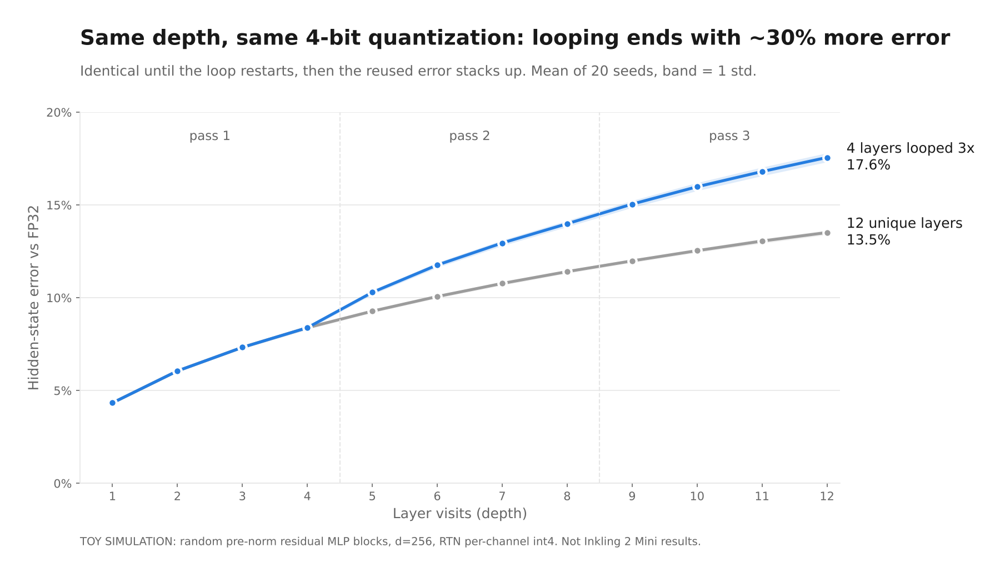

# LoopTax

**Weights that run in a loop pay their quantization error more than once.**

LoopTax studies how quantization error behaves in *looped transformers*, where a block of layers shares weights and runs several times per token. The first target is [Inkling 2 Mini](https://huggingface.co/blog/inkling2mini) from Thinking Machines Lab: 24 stored layers, 48 layer visits per token, with layers 6-17 running three times.


## The hypothesis

In a normal transformer every layer is quantized separately, so each layer's rounding error is different and they partly cancel, like independent noise. In a looped transformer the same quantized weights `W + ε` are applied on every pass, so the same error is applied repeatedly and adds up coherently.

If that holds, a bit spent on a looped weight is worth more than a bit spent on a weight that runs once, and uniform recipes (plain Q4_K_M, IQ4_NL and so on) leave quality on the table.

## Status

| Stage | Status |
|---|---|
| Toy simulation (random weights) | Done, see below |
| Per-layer KL sensitivity scan on Inkling 2 Mini | Planned |
| Loop-aware mixed-precision GGUF vs uniform community quants | Planned |
| Bits vs loop passes on the variable-loop checkpoint | Planned |

## Toy results

> **These are toy results.** Random pre-norm residual MLP blocks (d=256, hidden 1024), round-to-nearest symmetric per-output-channel quantization, hidden-state relative L2 error against FP. They are **not** Inkling 2 Mini measurements. Real models have outliers, learned gates between passes and NVFP4/MXFP8 source weights.

**1. Same depth, same 4-bit quantization (20 seeds).** The looped stack (4 blocks x 3 passes) ends with 17.6% error vs 13.5% for 12 unique blocks, about 30% more. The curves are identical until the loop restarts.



**2. Where to spend bits (Inkling-shaped toy: 24 blocks, blocks 6-17 looped 3x, 10 seeds).** At the same 4.5 average bits per weight:

| Loop bits | Edge bits | Final error |
|---|---|---|
| 5 | 4 | 14.8% |
| 4 | 5 | 22.1% |

Giving the extra bit to the loop beats giving it to the edges at every budget tested (3.5 to 7.5 bits).


### Reproduce

```bash
pip install -r requirements.txt
cd toy
python sim.py                                         # writes results.json
python -c "import json, sim; json.dump(sim.exp_grid(), open('grid.json','w'), indent=1)"  # bit-budget sweep (a few minutes on CPU)
python charts.py arch depth budget                    # writes ../assets/*.png
```

## Roadmap: the real experiment

1. **Sensitivity scan.** Quantize one layer at a time and measure output KL divergence against the reference model; compare looped (6-17) vs non-looped layers.
2. **Loop-aware quant.** Keep the looped block at higher precision and push the rest lower; compare quality per GB against uniform community GGUFs.
3. **Bits x passes.** On the variable-loop research checkpoint, grid over bit width and 1/2/3 loop passes.
4. **Release.** Publish quants on Hugging Face with the measurements.

## Related

- [Inkling 2 Mini on Hugging Face](https://huggingface.co/blog/inkling2mini)
- QDA: Closed-Loop LLM Quantization Design with Agents (arXiv 2611.23388), which uses output KL to score quantization recipes

## License

Apache 2.0
