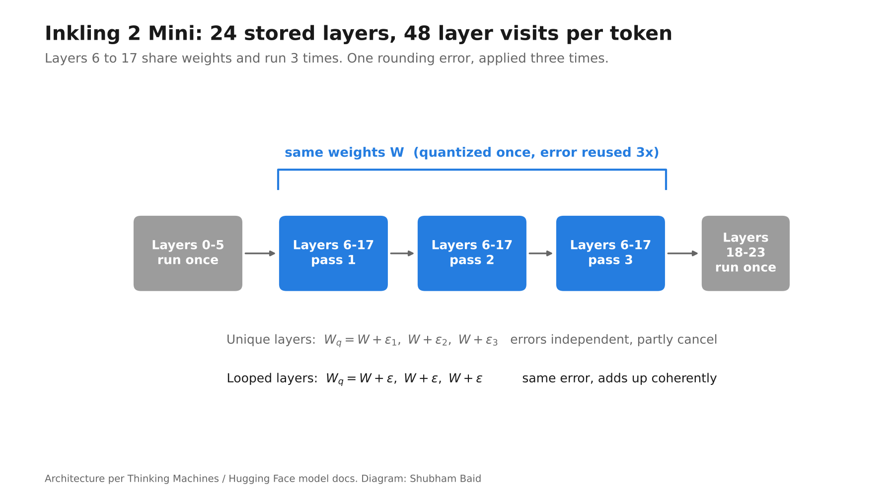
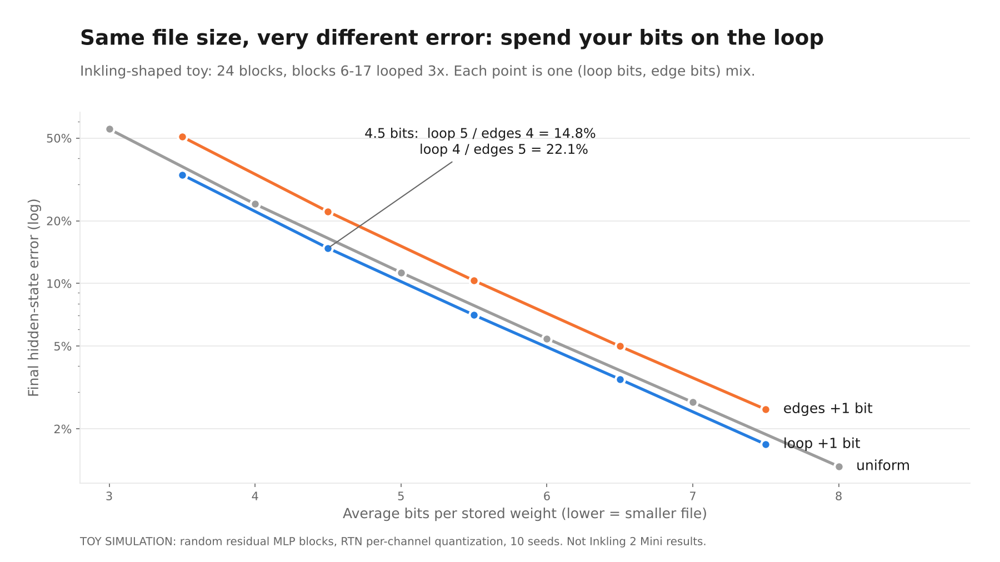

# LoopTax

**Does a looped transformer pay its quantization error more than once? On Inkling 2 Mini: no, reuse does not compound it.**

LoopTax tests a simple hypothesis on [Inkling 2 Mini](https://huggingface.co/blog/inkling2mini) from Thinking Machines
Lab, which stores 24 decoder layers but runs 48 per token: blocks 6-17 share weights and run three times. In a loop the
same quantized weights `W + e` are applied on every pass, so the error might add up coherently instead of averaging out
(the "loop tax"). If so, bits spent on looped weights would be worth more than bits spent elsewhere.

What we found (confirmed on held-out text where noted):

- **No compounding.** Quantizing one block of the variable-loop sibling checkpoint (TML-d24-varloop-research) and running
  it with 2-5 loop passes, the KL from the full-precision model at the same pass count scales like N^-0.28 to N^0.22
  for looped blocks and N^-0.13 to N^-0.04 for control blocks that run once after the loop. Compounding errors would
  scale like N^1 to N^2. Held-out confirmation over 2-5 passes, on text disjoint from the screening set: looped blocks
  9 and 17 at N^0.06 [0.00, 0.11] and N^0.19 [0.15, 0.24], control block 20 at N^-0.09 [-0.14, -0.05] (95% bootstrap CIs).
- **Position, not reuse.** Looped blocks are more sensitive, but already with a single pass: the middle of the network,
  and the attention of its global-attention layers (blocks 11 and 17) in particular, is what matters.
- **Why the intuition fails here.** Every pass restarts from the same prelude output; only a message read from the
  previous pass, through a learned rank-64 gate, carries over. An error made inside a pass is not re-processed by the
  shared weights the way the toy assumes.
- **FP4-trained weights should stay FP4.** The experts were trained and released in NVFP4. The ggml-org NVFP4 GGUF
  keeps them bit for bit. Against the BF16 GGUF it sits at KL 0.0024, which is below the noise of llama.cpp itself on
  this model (the same NVFP4 file run on CPU vs GPU: KL 0.0026), so it cannot be told apart from the release. A
  same-size Q4_K_M, which re-grids FP4-trained weights, sits at 0.0118, 4.5x that floor. This is about FP4-trained
  weights, not about formats in general.
- **No better quant to publish.** Under 16 GB, one type everywhere beats mixing, and at equal size bits in the loop
  beat bits at the edges (KL 0.0215 vs 0.0249 vs BF16), consistent with the position effect. At 16 GB and up,
  unsloth's UD-Q4_K_M, the NVFP4 file and all our recipes are within the measurement floor of the release.

All numbers come from `results/` and are traced in `notebook/LAB_NOTEBOOK.md`.



## Status

| Stage | Status |
|---|---|
| Toy simulation (random weights) | Done, see below |
| Setup: pinned llama.cpp, reference GGUF, eval set, GGUF layout check | Done (`docs/ARCHITECTURE.md`, `results/layout/`) |
| Phase 1: uniform baselines vs NVFP4 reference, community GGUFs | Done (`results/phase1-*`) |
| BF16 reference check | Done (`results/bf16check/`) |
| Phase 2: per-block and per-family sensitivity scan | Done (`results/phase2-scan/`) |
| Headline: same block, 1-6 loop passes, varloop checkpoint | Done, confirmed on held-out text (`results/phase4-*`) |
| Phase 4: bits vs loop passes | Done (`results/phase4-passes/`) |
| Phase 3: under 16 GB (sub-NVFP4 experts, scan-guided) and 16 GB+ (NVFP4 experts kept, attention tuned) | Done (`results/phase3-*`, floor: `results/floor-*`) |

**Held-out status.** Confirmed: `results/phase4-holdout/alpha_fit.json` (4 blocks, N = 1-5, 24 chunks of disjoint text).

The running log is `notebook/LAB_NOTEBOOK.md`.

## The intuition we tested (toy simulation)

> **These are toy results.** Random pre-norm residual MLP blocks (d=256, hidden 1024), round-to-nearest symmetric per-output-channel quantization, hidden-state relative L2 error against FP. They are **not** Inkling 2 Mini measurements. Real models have outliers, learned gates between passes and NVFP4/MXFP8 source weights.

**1. Same depth, same 4-bit quantization (20 seeds).** The looped stack (4 blocks x 3 passes) ends with 17.6% error vs 13.5% for 12 unique blocks, about 30% more. The curves are identical until the loop restarts.


**2. Where to spend bits (Inkling-shaped toy: 24 blocks, blocks 6-17 looped 3x, 10 seeds).** At the same 4.5 average bits per weight:

| Loop bits | Edge bits | Final error |
|---|---|---|
| 5 | 4 | 14.8% |
| 4 | 5 | 22.1% |

Giving the extra bit to the loop beats giving it to the edges at every budget tested (3.5 to 7.5 bits).



### Reproduce

```bash
pip install -r requirements.txt
cd toy
python sim.py                                         # writes results.json
python -c "import json, sim; json.dump(sim.exp_grid(), open('grid.json','w'), indent=1)"  # bit-budget sweep (a few minutes on CPU)
python charts.py arch depth budget                    # writes ../assets/*.png
```

## Roadmap: the real experiment

1. **Sensitivity scan.** Quantize one layer at a time and measure output KL divergence against the reference model; compare looped (6-17) vs non-looped layers.
2. **Loop-aware quant.** Keep the looped block at higher precision and push the rest lower; compare quality per GB against uniform community GGUFs.
3. **Bits x passes.** On the variable-loop research checkpoint, grid over bit width and 1/2/3 loop passes.
4. **Release.** Publish quants on Hugging Face with the measurements.

## Related

- [Inkling 2 Mini on Hugging Face](https://huggingface.co/blog/inkling2mini)
- QDA: Closed-Loop LLM Quantization Design with Agents (arXiv 2611.23388), which uses output KL to score quantization recipes

## License

Apache 2.0
